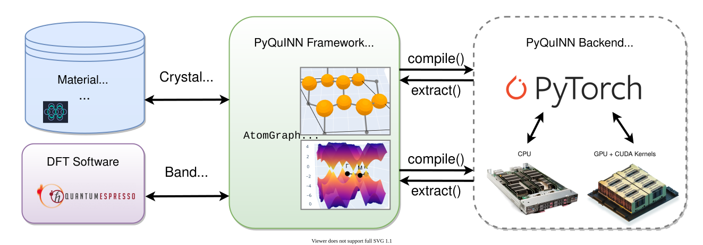

About PyQuinn
=============

PyQuinn is a framework for the design, training, and 
deployment of neural networks for predicting material and chemical
properties from atomic structure, with a heavy emphasis on efficiency,
modularity, and physical interpretability of models. 

PyQuinn also provides
many useful tools to aid in the generation and curation of high-quality
training datasets. PyQuinn is designed primarily to support `Quantum-Informed Neural Networks` 
(QuINNs), which are a type of Physics-Informed Neural Network (PINN), that 
combines aspects of first-principles quantum mechanical calculations with
classical machine learning models, all through the use of end-to-end 
differentiable modules that allow for the training of neural networks
and the optimization of materials at the atomic scale to have targeted
properties.

PyQuinn provides a unified, backend-agnostic API that supports data structure primitives
for representing materials, molecules, and other chemical systems.
These data structure can be compiled to target various backends, allowing for
rapid prototyping and development of models using popular frameworks like Pytorch.
Result data types obtained from each backend can then be extracted to convert
them back to the PyQuinn default type for easier manipulation.

At the moment, only the Pytorch backend is supported, but future support for
more frameworks is planned.

The AtomGraph Object
--------------------
At the core of PyQuinn is the :class:`~pyquinn.types.AtomGraph` class, which
represents a 3D atomic structure of atoms with support for periodicity. By 
convention, all spatial positions must be given in Angstroms (1Å = :math:`10^{-10}` m). 
An AtomGraph instance can be created and visualized as follows:

.. code-block:: python

    from pyquinn.types import AtomGraph

    # build a water molecule
    graph = AtomGraph(
        atoms=['O', 'H', 'H'],
        positions=[
            [0.0, 0.0, 0.119262], 
            [0.0, 0.763239, -0.477047], 
            [0.0, -0.763239, -0.477047]]
        )

    # visualize water molecule
    graph.plot()

.. seealso::

    There are more instance variables in the AtomGraph 
    which can be used for certain systems, such as periodic crystals or
    to incorporate atomwise or graphwise features to the graph.
    Visit the API reference page for :class:`~pyquinn.types.AtomGraph` to learn more.

Backend Compilation
-------------------

AtomGraph instances are straightforward to manipulate, since each instance variable is stored as a 
NumPy Array (:class:`~numpy.ndarray`). One can modify existing atoms, add new atoms, or obtain 
subgraphs using NumPy-style indexing. Since they are intended to be efficiently modified,
AtomGraphs do not keep track of "edges" between neighboring atoms. These edges
are only computed once the AtomGraph is compiled for a target backend using the
:meth:`~pyquinn.types.AtomGraph.compile()` function. When compiling a graph, the user must
supply appropriate cutoff radii for each atom in the graph such that if distance
between two atoms is less than the cutoff radii, then an edge is added between the two atoms.
To compile the graph we created above for the PyTorch backend with specific cutoffs, 
we call the ``compile()`` function as follows:

.. code-block:: python

    # compile graph
    torch_graph = graph.compile(
        backend='torch', 
        cutoffs={'H' : 1.0, 'O': 2.0 }
    )

    # access computed neighbors:
    print(torch_graph.neighbors)

The compiled graph has almost all of the same instance 
variables as the regular AtomGraph, except that these variables are
now array or tensor data types created on the corresponding backend. Additionally, a ``neighbors``
variable is added, which contains the indices of all neighbors of a given
atom (the index "-1" is designated as a padding value).

The ``extract()`` function recovers an AtomGraph from a BackendAtomGraph. Note, however, that this removes
any backend-specific features (such as neighbor lists, or computed gradients):

.. code-block:: python

    new_graph = torch_graph.extract()
    print(new_graph)

.. seealso::

    Visit the API reference page for :class:`~pyquinn.types.atom_graph.BackendAtomGraph`
    to learn about the functions supported by all backends.

Other PyQuinn Types
-------------------
In addition to AtomGraph, there are other types supported for compilation, such as:

* :class:`~pyquinn.types.AtomGraphDataset`
* :class:`~pyquinn.types.BandStructure`
* :class:`~pyquinn.types.BandStructureDataset`

These primitives all support efficiently saveable and loadable file formats, making the generation and
curation of large datasets simple.

Data I/O
--------
